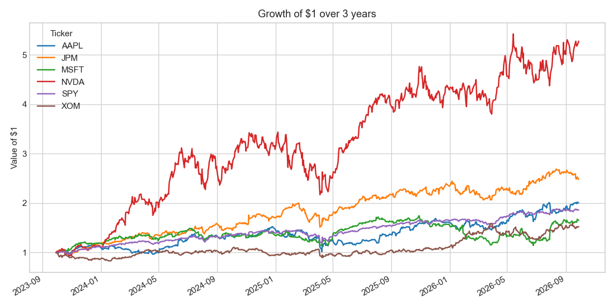
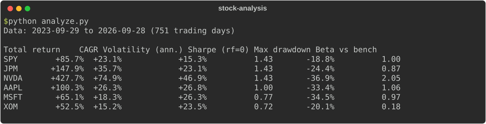
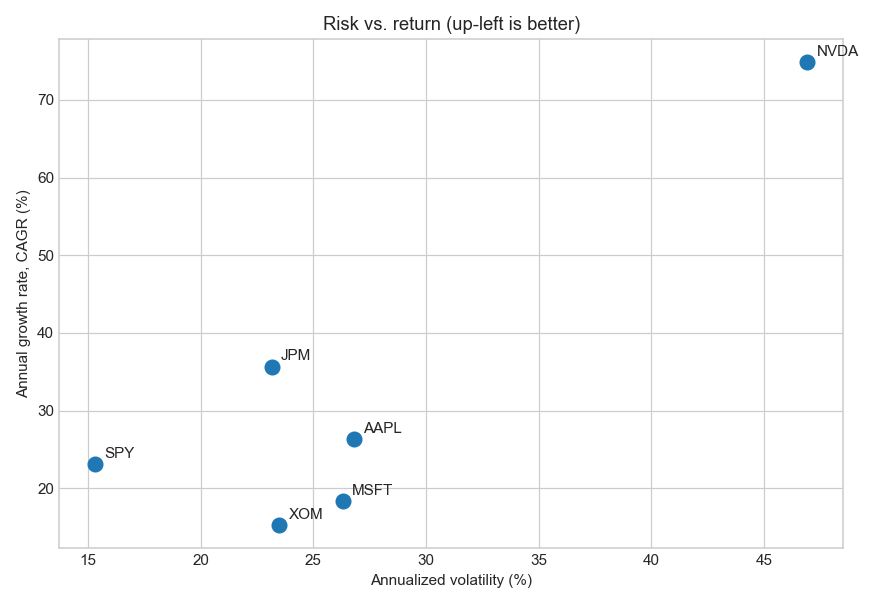
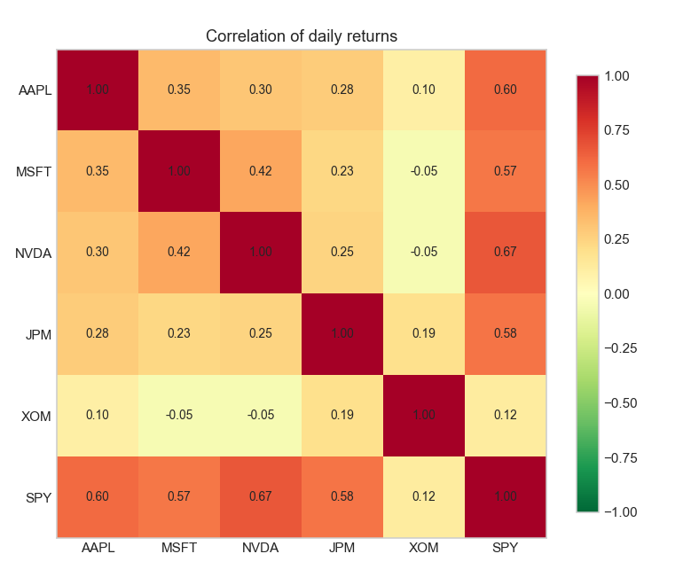
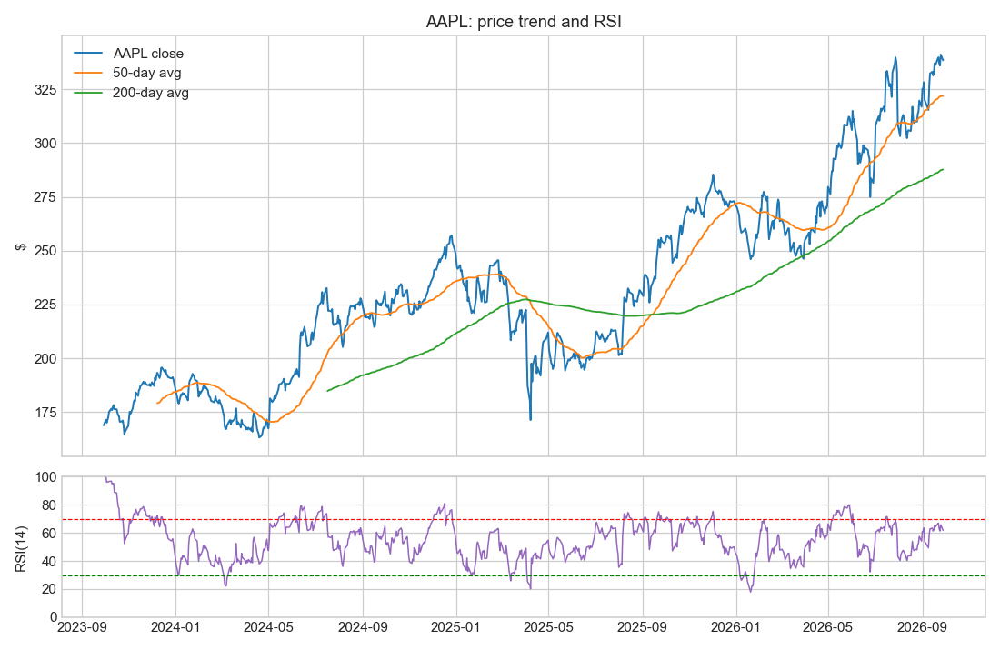
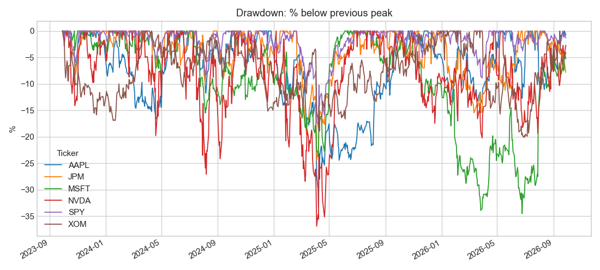

# Stock Risk & Return Analyzer

**Quick summary:** A Python script that downloads 3 years of real market data and compares stocks on return, risk, trend, and how closely they move together. It outputs a metrics table and five charts.



## Description
Give it any list of tickers (default: AAPL, MSFT, NVDA, JPM, XOM, and SPY as the benchmark). It pulls split- and dividend-adjusted prices from Yahoo Finance and calculates:

| Metric | Plain-English meaning |
|---|---|
| Total return / CAGR | How much it grew overall / per year on average |
| Volatility | How much the price swings day to day (a measure of risk) |
| Sharpe ratio | Return per unit of risk. Higher means you got paid more for the bumps |
| Max drawdown | Worst drop from a peak to a low. "How bad could it feel?" |
| Beta | How much it moves when the overall market (SPY) moves. 2.0 means twice as much |
| RSI(14) | Momentum gauge from 0 to 100. Above 70 is often called "overbought", below 30 "oversold" |



## Tools Used
- **Python**, **pandas**, **NumPy**: data wrangling and statistics
- **yfinance**: market data API
- **Matplotlib**: charts
- Unit tests for each metric (`test_analyze.py`)

## Scope
Historical, descriptive analysis only. Trade signals, backtesting, and live trading are out of scope. **Not financial advice.**

## Objective
Practice turning messy real-world data into clear, defensible numbers and visuals. That's the same skill used when analyzing logs, network traffic, or security metrics.

## Result
Data window: **Sep 29, 2023 to Sep 28, 2026** (751 trading days).

| Ticker | Total return | CAGR | Volatility | Sharpe | Max drawdown | Beta |
|---|---|---|---|---|---|---|
| SPY | +85.7% | +23.1% | 15.3% | 1.43 | −18.8% | 1.00 |
| JPM | +147.9% | +35.7% | 23.1% | 1.43 | −24.4% | 0.87 |
| NVDA | +427.7% | +74.9% | 46.9% | 1.43 | −36.9% | 2.05 |
| AAPL | +100.3% | +26.3% | 26.8% | 1.00 | −33.4% | 1.06 |
| MSFT | +65.1% | +18.3% | 26.3% | 0.77 | −34.5% | 0.97 |
| XOM | +52.5% | +15.2% | 23.5% | 0.72 | −20.1% | 0.18 |

**Findings**
- NVDA returned roughly 5× as much as SPY, but at 3× the volatility. Its Sharpe ratio was the same as the plain index fund. The extra return was paid for with extra risk.
- XOM has a beta of 0.18, so it barely follows the market. That makes it a diversifier, which the correlation heatmap confirms.
- Every single stock had a deeper worst-case drop than SPY. Owning one company is riskier than owning the whole market.

| Risk vs return | Correlation |
|---|---|
|  |  |




## What I Learned
- Why **adjusted** prices matter: raw prices "crash" on stock splits and make returns wrong.
- Annualizing: daily volatility × √252 trading days.
- Risk-adjusted thinking: a big return means little until you compare it with the risk taken to get it.
- Correlation is the math behind "don't put all your eggs in one basket."
- Writing small tests for financial formulas catches off-by-one and sign errors early.

## Run It
```bash
pip install -r requirements.txt
python analyze.py                          # defaults
python analyze.py TSLA AMD COST --years 5  # your own picks
python test_analyze.py
```
Outputs go to `docs/` (PNG charts and `summary.csv`).
